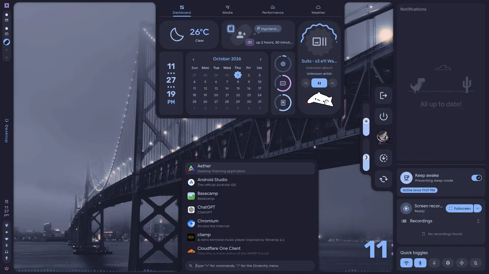
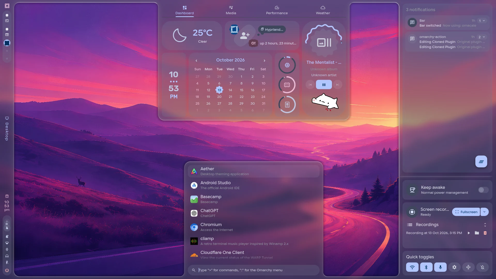

# Omacale

A [Caelestia](https://github.com/caelestia-dots/shell)-style desktop shell for [Omarchy](https://omarchy.org).

[](LICENSE)





- One Omarchy bar plugin (`omacale.bar`)
- Runs inside Omarchy's shell: no daemon, no build step
- Caelestia is the look, Omarchy is the engine

## Features

- **Frame and drawers**: dashboard, launcher, sidebar, utilities, session, settings
- **Liquid motion** (opt-in): spring drawers, liquid necks, presets (Settings › Motion)
- **Glass** (opt-in): frosted frame and drawers (Settings › Glass)
- **Colours**: Material 3 from the Omarchy theme, or the theme's own
- **Bar**: workspaces, active window, tray, clock, status icons, popouts
  - Any edge, per-screen position
  - Drag items to start / center / end
- **Taskbar apps** (opt-in): pin apps, app groups and folders; focus running apps, reorder pins and use per-app menus ([guide](docs/taskbar-apps.md))
- **Pickers**: wallpaper and theme carousels, "From wallpaper" via aether
- **Display** (Settings › Display):
  - Arrangement, resolution, scale, rotation, mirroring (via hyprmoncfg)
  - Keep-or-revert card, profiles, display menu
  - Per-screen brightness, night light, workspace placement
- **Launcher**: apps, `>calc`, `>clipboard`, `>wallpaper`, `>theme`, `:` menu
- **Dashboard**: weather, calendar, resources, media with lyrics
- **Notifications**: toasts above fullscreen, history sidebar
- **OSD**: volume and brightness sliders, other OSDs as toasts
- **Status toasts**: DND, game mode, charger, audio devices
- **Session menu**: custom commands, Lock, Screensaver
- **Workspace overview**: live previews, drag-and-drop
- **Lock screen**: Caelestia view on Omarchy's lock
- **Desktop clock and visualiser** (optional)
- **Plugin manager**: hosts Omarchy and third-party bar widgets
- **Keyboard-driven**: `h` `j` `k` `l`, Enter, Escape
- **Settings app**: everything applied live
- **UI scale**: follows Omarchy font size or custom

## Requirements

- Omarchy, shell running
- `jq`
- Material Symbols Rounded font (installer adds it)
- `cava` (optional, visualiser)

## Install

```bash
git clone https://github.com/AyushKr2003/omacale.git
cd omacale
./install.sh
```

Update: `git pull && ./install.sh` (settings kept).

| Command | Purpose |
|---|---|
| `./uninstall.sh` | Restore previous bar |
| `scripts/omacale status` | Show what is installed |
| `scripts/omacale doctor` | Check installation |
| `scripts/omacale install --dry-run` | Preview install |
| `scripts/omacale install --dev` | Symlink for development |

### Optional setup

- **Keybinds**: Settings › Keybinds, or paste [`keybinds.lua`](keybinds.lua) into `~/.config/hypr/bindings.lua`
- **Window styling**: add to `~/.config/hypr/looknfeel.lua`:

  ```lua
  pcall(dofile, os.getenv("HOME") .. "/.config/omarchy/plugins/omacale.bar/omacale.lua")
  ```

- **Toasts and OSD**: asked at install, on by default (`--osd` / `--no-osd`)
- **Lock screen**: opt-in (`--lock-screen`)
- **Remove**: `./uninstall.sh` (not `omarchy plugin remove`)

## Usage

### Keybindings

| Key | Action |
|---|---|
| `SUPER + A` | Launcher |
| `SUPER + D` | Dashboard |
| `SUPER + N` | Notifications sidebar |
| `SUPER + U` | Quick toggles |
| `SUPER + TAB` | Workspace overview |
| `SUPER + SHIFT + I` | Settings |
| `SUPER + SHIFT + ESCAPE` | Session menu |
| `SUPER + CTRL + 0` | Bar focus |
| `SUPER + CTRL + W` / `B` / `P` / `A` | Network / Bluetooth / Power / Audio |
| `SUPER + CTRL + 1..9` | Third-party bar widgets |

### Keyboard navigation

| Key | Action |
|---|---|
| `h` `j` `k` `l` / arrows | Move |
| `Enter` / `Space` | Activate |
| `Tab` / `Shift + Tab` | Next / previous |
| `x` | Remove |
| `Escape` | Close / back |

<details>
<summary>Keys for each panel</summary>

| Panel | Keys |
|---|---|
| Bar focus | `1..9` workspace; `Menu` / `Shift + F10` tray menu |
| Tray menu | `→` submenu, `←` back |
| Network | `r` rescan |
| Audio | `m` mute; `←` / `→` volume |
| Dashboard | `1..4` tab; `n` / `p` track |
| Sidebar | `d` DND, `Shift + X` clear all |
| Settings | `/` search, `Backspace` back |
| Launcher `:` | `Enter` / `→` open, `Backspace` / `←` back |
| Launcher `>clipboard` | `Enter` paste, `Shift + Enter` copy, `Alt + Enter` open, `Delete` remove, `Shift + Delete` clear |

</details>

### Command line

```bash
omarchy-shell omacale <launcher|dashboard|sidebar|utilities|overview|session|settings|close>
omarchy-shell omacale <wallpapers|themes|menu|clipboard|windowInfo|barFocus>
omarchy-shell omacale dashboardTab <dashboard|media|performance|weather>
omarchy-shell omacale settingsPage <page>
omarchy-shell omacale popout <network|bluetooth|audio|battery|kblayout|lockstatus|update|activewindow>
omarchy-shell omacale taskbarAppsStatus  # enabled state, app/pin counts and screen readiness
omarchy-shell omacale scale <omarchy|0.5-2|50%-200%>
omarchy-shell omacale toast <info|success|warning|error> <title> <message> <icon>
```

## Omarchy integration

- **Notifications**: Omarchy keeps the daemon and history; Omacale draws toasts. Falls back to Omarchy's toasts if Omacale isn't the bar.
- **Lock screen**: Omarchy keeps lock and PAM; Omacale draws the view. Opt-in, since the view sees the typed password.
- **OSD**: Omarchy keeps keys and brightness; Omacale draws. Handed back on fullscreen.
- **Scale**: follows `shell.toml` (`[font] base-size`, `[spacing] scale`).
- **Updates**: copies rebuilt after `omarchy update`; Omarchy's original restored if one breaks.

<details>
<summary>Manage handovers by hand</summary>

```bash
scripts/notif-popups <status|install|remove|health>
scripts/lock-screen  <status|install|remove|health>
scripts/osd-handover <status|install|remove|health>
```

</details>

## Development

```bash
./scripts/omacale install --dev       # live-editing symlink
bash tests/test-restore.sh            # test suite
node tests/test-layout.js             # bar layout
node tests/test-taskbar-apps.js        # pin, group and window models
python3 tests/test-taskbar-ui.py       # Qt UI with mock host services
python3 tests/test-taskbar-quit.py     # quit helper with disposable processes
python3 tests/test-taskbar-preview.py  # deployment and recovery
node tests/test-binds.js              # keybinds parser
node tests/test-theme-mode.js         # light/dark rule
bash tests/test-shell-toml.sh         # shell.toml colours
node tests/test-screens.js            # per-screen rules
scripts/upstream-check                # Omarchy changes since last verified
```

- Architecture: [`CLAUDE.md`](CLAUDE.md)
- Changes: [`CHANGELOG.md`](CHANGELOG.md)

## Limitations

- Fullscreen windows hide OSD and toasts (Omarchy's OSD shows instead)
- No battery, VPN or keyboard-layout toasts
- Lock screen blur falls back to wallpaper if no snapshot
- Notifications: default action only, no inline reply
- Liquid motion has no refraction (Quickshell can't see behind its window)

## Credits

- UI and shaders: [caelestia-dots/shell](https://github.com/caelestia-dots/shell) (GPL-3.0)
- Liquid motion: [Vitreus](https://github.com/natepayn3/Vitreus) (MIT), [pleamar](https://github.com/k4ditano/pleamar)
- Overview: [omarchy-overview](https://github.com/AyushKr2003/omarchy-overview), [quickshell-overview](https://github.com/Shanu-Kumawat/quickshell-overview)
- Fonts: Google Sans Flex, Rubik (OFL)

## License

[GPL-3.0](LICENSE). Some files keep their own licenses (AGPL-3.0, MIT, BSD-3-Clause). See [THIRD_PARTY.md](THIRD_PARTY.md).
