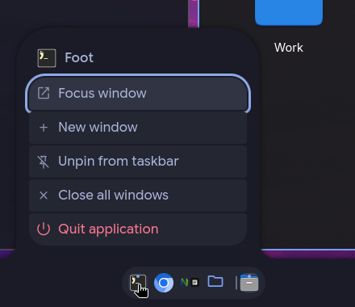
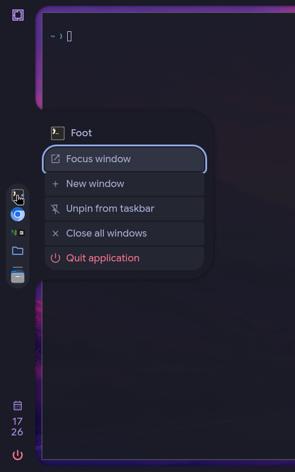
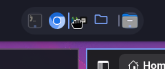
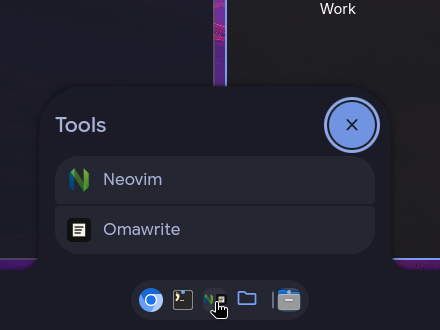
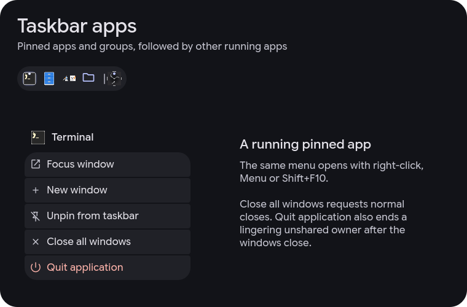
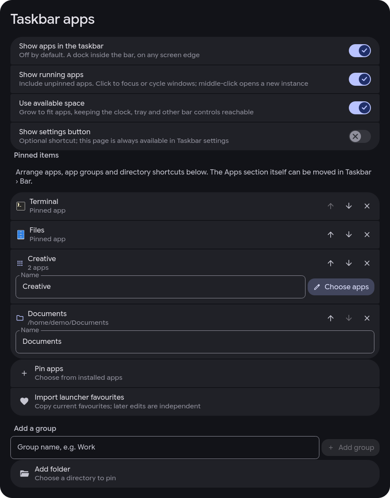

# Taskbar apps

Settings › Taskbar › Apps enables a dock inside the existing bar. It is **off
by default**, and no app entry is instantiated while it is off. It neither
reconfigures nor disables Omarchy's separate dock.

## Using it

- **Pin apps** opens a searchable picker of apps visible to Omarchy and Omacale's
  launcher. An app can also be pinned from Settings › Apps › All apps › App info.
- **Import launcher favourites** copies the current list. Later edits to either
  list are independent.
- **Add a group** creates a named container; **Choose apps** edits its members.
  The bar shows up to four small app icons. Click it for a scrollable app list.
- **Add folder** opens the existing Omacale picker in directory mode. Choose a
  folder and confirm **Select folder**; its name is used automatically and can
  be edited afterwards. It opens in the default file manager. This is a directory
  shortcut, separate from the app containers above.
- Move pinned items up/down, rename groups and directory shortcuts, or remove
  them on the same page. Move the entire Apps section using Taskbar › Bar, like
  any other built-in item. Configuration remains available while it is disabled.
- **Show running apps** appends unpinned running apps. Group members are kept
  inside their group; they are not appended again. Explicit standalone pins can
  coexist with membership in a group.
- Click an app to launch it, focus its window or cycle its windows. Without an
  active window of that app, prefer the current workspace. Middle-click opens
  another instance. A dot marks running apps; a filled surface marks the active
  one. Right-click opens that item's action menu, including pin/unpin, new
  window, close all windows and quit application. Menu or Shift+F10 opens the
  same menu from the bar's keyboard cursor.
- Saved pins come first, followed by a divider and the remaining running apps.
  Unpinned running apps are dimmed until hovered or active. The divider is
  absent when either section is empty.
- Drag pins to reorder them; drag a running app into the pin section to pin it.
  An insertion line previews the drop; releasing outside cancels it. Hidden or
  unavailable pins keep their saved position. Near a clipped edge, moving the
  pointer scrolls the list to reveal more targets.
- **Use available space** lets the section grow with its contents up to the
  bar's shared space budget. Turn it off to choose **Visible slots** (1–100).
  The tray and plugin pill keep their minimum space and overflow scrolls on the
  bar's own axis. **Show settings button** is off by default; Settings › Taskbar
  › Apps always remains available.
- Super+Ctrl+0 reaches the section through the existing bar focus cursor. Moving
  through it scrolls hidden slots into view. Enter on a group opens the existing
  keyboard-driven popout; Escape returns to the bar. Outside-click closes it.

Unavailable or hidden app pins are kept in settings and left out of the bar.
They reappear when the app is available again. Other special-workspace windows
and child/transient windows stay out; Omarchy's `special:minimized` windows can
be restored. App identification uses desktop-entry lookup and the explicit
terminal app IDs used by Omarchy's TUI launcher.

**Close all windows** asks each matched window to close normally. **Quit
application** additionally stops an otherwise lingering window-owner process
after all of its windows close. An open window or a new save dialog prevents
termination. Shared browser processes are retained, and web-app shortcuts never
terminate the browser process. Quit is available while the app has windows to
identify it; it does not search for background processes by name.

The quit helper runs only on explicit selection, through the unmodified Omakit
Run block with an eight-second deadline and bounded output. It validates fresh
compositor window/PID/class identities, opens pidfds, protects the shell and
other users, and sends SIGTERM only after the close flow succeeds. It does not
use SIGKILL, process-name matching, a shell string or a periodic process probe.

## Controlled development preview

The CLI was re-enabled only after repairing the reload transaction, adding its
failure regressions, building the native runtime correction separately, and
verifying the corrected runtime with the existing Omacale bar and notification
service. The runtime correction is not part of this plugin or a hidden feature
dependency; see the incident analysis below. Do not deploy bulk file changes
into a plugin while the shell is watching it.

From a clean, committed checkout with Omacale already selected:

```bash
python3 scripts/taskbar-preview.py start
python3 scripts/taskbar-preview.py restore
```

The helper backs up the installed plugin and changed settings. It prepares the
complete new version **outside the recursive plugin watch tree**, on the same
filesystem. Hidden folders inside the plugin tree are still watched by
inotify, even though the host filters their reload signals.

It gracefully stops the existing shell, waits for its Omarchy supervisor too,
and checks absence again immediately before directory renames. It uses
Omarchy's existing restart command and waits for `taskbarAppsStatus` to identify
an actual Apps entry in the loaded Omacale bar. A core ping alone is insufficient.
Install and rollback follow the same stop-before-publish rule. An empty
`quickshell list -a -j` may be the literal `No running instances.`; the parser
accepts it. All commands have deadlines and a transaction lock prevents overlap.

On failure, the original error is printed and saved before recovery. A failed
publish restarts the original shell; a successful publish followed by a failed
probe restores the backup. Recovery errors do not replace the original error.
Restore refuses to overwrite later edits to the installed plugin. Settings use
a three-way rollback: only preview-written leaves that still match are reverted,
while later or unrelated edits are kept. Backups, logs and screenshots are in
`$XDG_STATE_HOME/omacale/taskbar-preview` (normally
`~/.local/state/omacale/taskbar-preview`). An optional `--checkout` imports a
branch with Git and only fast-forwards; normal source selection should be done
before deployment.

### Incident analysis

Three separate concerns must not be conflated:

1. **Native race.** Official Quickshell `0.3.2.r7.g2b4501a-5` still contains
   Omarchy's scanner call from the URL interceptor. `-5` was a dependency rebuild,
   not a race fix. [Omarchy issue #16167](https://github.com/omacom/omarchy/issues/16167)
   was open during the 2026-10-29 investigation; its current status is not claimed here. The local package repair is maintained separately in
   `omarchy-pkgs`: interception only routes URLs; each network manager owns its
   late scanner, four mutable scanner collections and pragma QJSEngine. Initial
   generation intercepts are read-only. The built package and actual interceptor/
   scanner tests cover explicit and implicit local modules, conditionals,
   singletons and concurrent loading. A first pure-rewrite candidate broke
   implicit QML types on the desktop and was immediately rolled back. The
   corrected `5.2` package loads the original bar and notification service.
   Successful starts support this finding; the ownership change is the source
   argument for removing this specific race.
2. **Reload storm.** The first preview copied into the active plugin. The journal
   records 314 reload messages around 13:50 on 2026-10-29, immediately before a
   native import-loading crash. The host has one recursive plugin watcher and
   emits a signal per file event; its reload timer coalesces the later work, not
   those messages. The installed Omacale copy matched all 290 baseline files;
   no runtime bytecode/writer was found there. Staging outside the watch tree
   and publishing only after shell/supervisor exit removes this deployment cause.
3. **Recovery bug.** The next trial successfully stopped the shell, then parsed
   its non-JSON empty inventory as JSON and skipped restart. Regressions now cover
   that exact response, a query failure after quit, simultaneous recovery failure,
   supervisor backoff, publication failure and rollback ownership.

The startup crash at 14:49 has the same `comparesEqual(QDir, QDir)` / import-loader
stack in the original coredump/report. This is consistent with the confirmed
native race; it is not evidence of a separate Apps QML crash. No OOM was recorded.
The live feature acceptance results below are recorded independently from both
the mocked tests and native package tests.

## Settings and ownership

`bar.apps` defaults to:

```json
{
  "enabled": false,
  "showRunning": true,
  "useAvailableSpace": true,
  "showSettings": false,
  "maxShown": 8,
  "items": []
}
```

`items` is an ordered array persisted by the existing Config/JsonAdapter:

```json
[
  { "id": "app:firefox", "type": "app", "app": "firefox" },
  {
    "id": "group:work", "type": "group", "name": "Work",
    "apps": ["code", "org.gnome.Nautilus"]
  },
  {
    "id": "folder:projects", "type": "folder", "name": "Projects",
    "path": "/home/example/Projects"
  }
]
```

Desktop IDs are stored without the `.desktop` suffix. App pin IDs are derived
from their desktop IDs. Group and directory IDs stay stable when renamed.
Unknown types, relative directory paths, malformed items and duplicate IDs are
ignored. Missing apps remain saved. An empty group remains editable.

`core/TaskbarApps.js` holds pure normalization, editing, item ordering and
window-selection rules. `services/TaskbarApps.qml` supplies shared reactive data
and actions. It does not poll. Its window list is empty without subscribing to
Hyprland windows while the feature is disabled. Launches use Omarchy's injected
AppLibrary when exposed. Bar capability proxies have no AppLibrary, so terminal
entries use Omarchy's TUI launcher through `Util.execArgv`; other entries use the
existing launcher's desktop-entry execution. Existing Sys helpers perform window
actions, with native bare hexadecimal addresses normalized to Lua selectors. Paths never become
shell commands: Qt opens one percent-encoded file URL with the default handler.

`AppsEntry` keeps a keyed ListModel, so window updates and reorders preserve
slots and in-progress pointer presses. The usual bar entry registration,
section layout, screen edge, space budget and keyboard cursor apply.
`AppsGroup` lives inside the existing PopoutContent/ScreenScope frame, including
its glass and motion styles; clicking a group holds the popout's keyboard using
the established `openPopoutKeys` path.

## Automated verification

```bash
node tests/test-taskbar-apps.js
node tests/test-layout.js
node tests/test-settings.js
python3 tests/test-taskbar-ui.py
python3 tests/test-taskbar-preview.py
```

The Qt 6 test runner loads the actual new components, tokens and controls in an
offscreen window with mock Config, desktop-entry, Hyprland and host services.
Warnings fail the test. It checks loading and switching edges, capped lengths,
slot identity across window changes, group opening/closing/removal, launch and
window-cycle actions, minimized/TUI windows. Pure JS tests cover encoded directory URLs. It does not
start another Quickshell process or change the user's desktop/configuration.
It does **not** verify real JsonAdapter disk persistence, compositor IPC, icon
lookup, or the running shell's pointer/focus integration. The BarContent budget
and entry loader are exercised with the real AppsEntry and deterministic
stand-ins for the other built-ins, including 20 pins and keyboard scrolling.

## Desktop verification — 2026-10-29

The feature was imported with Git into the requested checkout and installed as a
regular copy in the already-running Omarchy shell. The original feature and
recovery commits retain their authorship. No release version/changelog was changed.

Environment: one real eDP-1 display, 2560×1600 at compositor scale 1.6; Omacale UI
scales 0.85 and 1.2; Qt 6.12.0; locally built, package-managed Quickshell
`0.3.2.r7.g2b4501a-5.2`. The previous official package and configuration are saved
outside the plugin tree. The local runtime patch belongs to omarchy-pkgs, not this
contributor change.

| Check | Observed result |
| --- | --- |
| Default/off | No Apps entry or gap; real screenshots and status checked on left, right, top and bottom. |
| Pins/settings | Pinned Foot and Omacalc through the picker; reordered, removed, created/renamed a group and edited its members through the UI. |
| Directory shortcut | Added a path containing spaces, `#` and `?`; Strata, the configured directory handler, opened the exact directory. |
| Launch/windows | Foot launched, middle-click created another window, subsequent clicks focused/cycled the real windows. A real window moved to `special:minimized` was restored to the current workspace and focused. |
| Terminal apps | Neovim launched in Ghostty as `org.omarchy.nvim`; refocusing retained one window. The previous raw-command fallback had started orphan commands; those test processes were cleaned up. |
| Web apps | YouTube launched in Brave. Matching the Chrome desktop class to Brave's class fixed duplicate launches; later clicks focused/cycled the two existing test windows without adding another. |
| Group input | Pointer and bar-keyboard opening, keyboard activation, Escape, outside click, removal while open and disabling while open checked on the compositor. Screenshots confirm closing/focus release. |
| Group scrolling | A long list of installed apps scrolled inside the existing popout. |
| Edges/style | Group popouts viewed on all four real edges; glass, Morph and Liquid viewed on the left edge. |
| Crowding/scale | 23–24 saved items, 25 visible app items at 120% UI scale on the real display; section capped and scrolled while power/clock remained reachable. |
| Keyboard scrolling | Found and fixed a stale shared focus-ring rectangle. The Qt regression fails without the explicit Flickable offset dependency (768 versus 305); the corrected desktop screenshot puts the ring on the revealed tune button. |
| Wheel scrolling | Real wheel input scrolled the constrained Apps section in both directions. |
| Persistence | A controlled shell restart preserved the captured five-item configuration, membership, order, enabled state and slot cap exactly. |
| Successful rollback | Repeated real restore/start cycles restored the exact prior plugin and kept unrelated settings. |
| Failed-preview recovery | An injected readiness failure after real publication restarted and restored the prior plugin; its digest matched, the original error was saved, and exactly one Omacale shell answered afterwards. |
| Runtime evidence | No new Quickshell crash reports during the corrected runtime/feature trials; no bulk deployment reload storm. Relevant feature logs checked alongside screenshots. |

Later pins added during acceptance were preserved. Temporary test groups/folders,
UI scale and edge changes were removed/restored. Private desktop captures remain
local under the preview state directory; they are not contributor-PR attachments.
Multiple monitors were unavailable and were not simulated. Native race freedom is
argued from ownership and regression tests, not from a finite number of starts.

## Interaction acceptance — 2026-10-31

The follow-up was installed with the same controlled restore/start transaction.
The settings shortcut is hidden by default; the user's eight existing pins,
order, 16-slot saved cap, bottom edge and 0.85 UI scale were preserved.

Real compositor checks, separate from the mocked-host Qt tests:

- Right-click showed the app-specific menu. The Menu key opened the same menu;
  pin and unpin actions were exercised and persisted through the actual adapter.
- Native pointer drags pinned a running test app at the front, then moved that
  pin to the end. Unpinning restored the original eight-item array exactly.
- A compiled Qt fixture opened two windows but deliberately kept its process
  alive after both closed. Selecting **Quit application** through the real menu
  closed both and terminated that background owner with SIGTERM (exit `-15`).
  The other applications' processes stayed alive. This exercised the actual
  Run supervisor, helper, compositor socket and pidfds, not a mocked process.
- The separator was visible between the eight pins and the running fixture;
  it disappeared when there was no separate running section. Qt checks cover
  the dimmed/active/hovered icon states.
- Menu captures were viewed on left, right, top and bottom after layout settled.
  A real three-slot limit and available-space mode were captured and compared.
- Exactly one shell remained, no new Quickshell crash report appeared, and the
  feature/Run logs contained no new warnings. Temporary launcher entries and
  test windows were removed. Private captures remain outside the repository.

The early input attempts were not acceptance passes: the virtual pointer needed
time to deliver its press before the test warped the cursor. After correcting
that test driver, the complete menu/pin/drag/quit trial passed in 18 seconds.
Multiple monitors were unavailable and were not simulated.

The interaction Sol loop used the configured native `gpt-6.1-sol` route for two
rounds, ending APPROVE on the behavioral candidate `7c8565f`. S1 (native terminal
`--app-id` mistaken for a web app), S2 (a drop among running apps unintentionally
pinning it), and S3 (menu-close state cleanup before committing an action) were
resolved with focused regressions. No findings were declined. The reviewed diff
grew from 22 files / 1,616 insertions / 84 deletions to 22 / 1,684 / 87, mainly
regressions and the small corrections. Independent model/provider metadata and
usage were not returned; no usage figures are inferred.

Omakit reports the Run 0.2.1 block unmodified. Its local baseline has no findings
and requires human review for existing capabilities; the offline submission
preflight is ready. `omakit weigh` refused `plugin-is-bar`: replacing a whole
bar is outside that measurement's contract. No weight or marketplace approval
is claimed.

### Regression coverage and existing failures

The three focused JS suites pass. Qt UI has **31 passing cases** using actual
components and mocked host services, including bare native addresses, a bar host
without the menu AppLibrary capability, cross-browser web-app classes, folded
space allocation and the scrolled shared cursor. The real FolderListModel and
picker controls cover directory-only listings, empty-folder selection, navigation,
cancel, automatic pin names, and unchanged image-file filtering. A Qt
FolderListModel double-decoding quirk is handled locally so literal `#`, `?` and
`%` in directory names survive listing. Preview has **28 passing tests**,
including empty inventory, failed post-quit verification, supervisor retry backoff,
failed publication, settings without a prior Apps dictionary, later installed
edits, diagnostics-write failures and cleanup failures after publication.

The interaction follow-up also covers right-click menus, pin/unpin, optional
settings, available-space/manual sizing, separator/emphasis state, real Qt
pointer drags on both axes, and a dragged running app becoming a pin. The
quit helper has **8 process tests** using disposable processes: full closure,
background termination, unselected/shared processes, web-app isolation,
unsaved/new dialog handling, changed identities and shell protection.

The source build and native regression compile actual patched C++ and moc code,
exercise 400,000 concurrent interceptions, four private scanner threads, explicit
and implicit late modules, singletons and preprocessor directives. This is
separate from Qt UI's mocked host integration.

Repository bind, theme-mode, shell-toml and screen tests also passed. On both this
feature and an untouched `aacad54` archive, facade checking lacks
`notePopoutCard`, `popoutCardFor`, `traySectionDragActive`, and
`traySectionPopoutOpen`; restore testing stops at the notification-daemon patch.
Upstream checking also encounters the baseline non-executable facade test.
Those existing host compatibility failures have not been relabeled as Apps bugs.

Sol-loop used one harness-selected native `gpt-6.1-sol` route, five rounds (the
last two for newly found UI-state/recovery defects), with all findings resolved.
The harness accepted that explicit model route; the child did not independently
expose provider/model metadata or usage. No usage figures are inferred.

## Current-main verification — 2026-11-03

`origin/main` at `1f496d3` was merged into the feature branch as `4f0be74`.
The merge keeps main's condensed README, new Material popout loaders and
scroll-aware keyboard navigation. No release version or changelog was changed;
release bookkeeping belongs to the maintainer when accepting a contribution.

- All nine `tests/test-*.js` suites pass, including apps, layout and settings.
- Qt UI: 31 passed; preview/recovery: 28 passed; quit helper: 8 passed.
- The bar facade passes all 34 contract members.
- The whole feature diff against `1f496d3` received one fresh Sol review,
  APPROVE with no blocker/should findings. The configured native route was
  `gpt-6.1-sol` on high effort; the child did not independently expose model,
  provider or token-usage metadata. The behavior diff did not change in review
  (41 files, 4,264 insertions, 38 deletions); only this documentation and the
  public screenshots/evidence were added afterwards.
- A controlled installation of `4f0be74` answered `taskbarAppsStatus` with one
  ready bottom-edge screen and five running app entries. Exactly one shell
  remained. No AppsEntry, AppsMenu, TaskbarApps or Run warnings were found in
  that shell's log. Its current empty pin list and other preferences were kept.
  This is a startup smoke check, not a repeat of the October pointer acceptance.

### Omakit lab

`omakit lab prove run` returned **PROVED**, `ok over 19 scenarios`:
run `20261103-151358-run`, stock guest `omarchy 4.0.4-1`, kernel
`7.2.5-3-omarchy`, ISO SHA-256
`ddeded2758c48318d201dfdac905ecb28f570441883f0c052ea3cd5d05acf92d`,
`skew: false`. It took 159,918 ms. Every scenario reported zero survivors and
zero hostile-environment shadow hits. The base was unchanged and the disposable
overlay was removed. Omarchy 4.0.6 was available; this run used the existing
4.0.4 base, so it does not claim validation on the newer release.

The suite's Run 0.2.1 implementation bodies match the vendored block exactly;
only their source-commit header stamp differs. The portable result is in
[taskbar-apps-lab.json](taskbar-apps-lab.json). The original local bundle is
`$XDG_STATE_HOME/omakit/lab/runs/20261103-151358-run/` (`run.json`,
`runlab.json`, `host.log`, `runlab.log` and the scenario archive).

Omakit lab's shipped CLI offers only Run, Store and weigh suites. It has no custom
plugin or pointer-input scenario, so this proof covers the Run plumbing used
for Quit, not this taskbar's app menu, drag/drop, compositor close flow or
multi-monitor behavior. The actual-component Qt tests cover those UI rules
with mocked host services; real October desktop acceptance remains historical.
Whole-bar weighing is unsupported (`plugin-is-bar`), so no weight is claimed.

### Baseline compatibility limits

On both the feature and a clean `1f496d3` archive:
`test-lock-blank.sh` has two passes and one failure against the installed lock
service; `test-restore.sh` reaches 89 passes and four lock-watchdog failures,
then exits 2 because the expected clone was not recreated. These are unchanged
main/host compatibility failures. `python3 scripts/upstream-check` also reports
host changes since the recorded lock. That lock was not rewritten to claim
untested compatibility. Historical facade failures above no longer apply to
the current main merge: the current 34-member facade check passes.

Omakit verify reports no findings and requires maintainer review for the
plugin's existing capabilities. Offline submission preflight is ready. Its
advisory inventory includes existing processes, writes, network calls and the
repository's existing agent guidance; this is not marketplace approval or a
security-review verdict.

## Native compositor captures — 2026-11-04

The maintainer requested real bar captures in
[PR #37](https://github.com/AyushKr2003/omacale/pull/37#issuecomment-6631541749).
The images below come from the real Omacale plugin at `f52b15f`, installed in
an Omakit disposable guest and rendered by its actual Quickshell/Hyprland
session. No host services or windows are mocked in this runtime.

The installed Omakit 0.6.11 CLI has no custom-plugin capture suite. A dedicated
product-owned scenario called its unmodified `withGuest`, preflight, lock,
SSH and QMP modules directly. This is a custom Omakit-engine capture run,
**not** a shipped `omakit lab prove` suite or a `PROVED` verdict. Omakit itself
was not modified. The VM used the existing stock `omarchy 4.0.4-1` base,
Quickshell `0.3.1-1`, Qt `6.11.2`, one 1280×800 output at scale 1, Tokyo Night
and Omacale UI scale 1. The required Material Symbols Rounded font was supplied
inside the disposable overlay before the shell started.

Configuration: Foot and Chromium pins, a **Tools** group containing Neovim and
Omawrite, a **Projects** directory shortcut, and a separately running Nautilus.
Foot and Nautilus are actual applications with compositor windows. The theme,
palette, frame, menus, group popout and icons are drawn by the actual plugin.
The settings shortcut is off. Captures use `grim` inside the guest, with integer
regions; the published PNGs are copied byte-for-byte, without pixel edits.

QMP right-clicks opened the five-action Foot menu on bottom and left bars; OCR
checks found both Close all windows and Quit application in each capture.
A native pointer drag on the top bar faded the source and showed the insertion
line; release persisted Chromium before Foot. A native click then opened the
Tools group on the bottom bar. These menu, drag and group images were visually
inspected. The run did not select Quit or repeat the full October acceptance.

Run `20261104-172535-omacale-capture` kept exactly one guest shell, preserved
the base, powered off the guest and removed its overlay. Local full captures,
logs, configuration and the scenario are under `$XDG_STATE_HOME/omakit/lab/`;
the portable provenance and image digests are in
[taskbar-apps-native-capture.json](taskbar-apps-native-capture.json). That record
also lists the four observed shell warnings: duplicate `omarchy.bar` IPC
registration, host-portal app-ID registration, absent BlueZ object manager and
an empty file-watcher path. None named the new Apps components; no whole-shell
clean-log claim is made.

**Bottom edge, real app menu and running-app divider:**



**Left edge, menu over the real frame and terminal window:**



**Top edge during the native pointer drag:**



**Bottom edge, Tools group open:**



[Wider native bar/frame context](taskbar-apps/native-frame.png) is also included.

### Earlier isolated UI illustrations

These are isolated Qt renders of the actual feature components, using a fixed
dark palette, real app icons and deterministic sample apps/windows. Host
services are mocked, and surrounding headings/explanations form a presentation
fixture. They illustrate the UI without exposing a user's desktop and are not
compositor acceptance evidence. The settings body and controls are actual
`TaskbarAppsPage`/`RowToggle` components; the four setting rows mirror the
page model. Bar/menu sizing, rows, grouping, divider and insertion line come
from the unchanged components.





